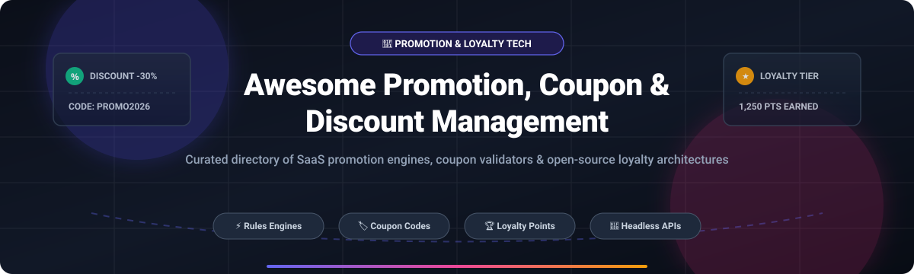

# 🏷️ Awesome Promotion, Coupon & Discount Management

 

  <strong>A curated list of top Promotion, Coupon, and Discount Management platforms, Headless Promotion Engines, Loyalty Rule Systems, and Open-Source Codebases.</strong>

  <a href="#-sector-overview--market-dynamics">Sector Overview</a> •
  <a href="#-saas--hosted-platforms">SaaS Platforms</a> •
  <a href="#-open-source-software">Open-Source Engines</a> •
  <a href="#-feature-matrix--comparison-at-a-glance">Feature Matrix</a> •
  <a href="#-contributing">Contributing</a>

🌟 **Star this repo if you find it useful!** 🌟

---

## 📋 Table of Contents

- [🌐 Sector Overview & Market Dynamics](#-sector-overview--market-dynamics)
- [🟦 SaaS / Hosted Platforms](#-saas--hosted-platforms)
- [🟩 Open-Source Software](#-open-source-software)
- [📊 Feature Matrix & Comparison at a Glance](#-feature-matrix--comparison-at-a-glance)
- [🤝 Contributing](#-contributing)
- [💖 Support](#-support)
- [📈 Star History](#-star-history)
- [📄 License](#-license)

---

## 🌐 Sector Overview & Market Dynamics

The global promotion and loyalty management software market is valued at approximately **$13.5B to $16.4B** and is projected to expand to **$31B–$57B+ by 2034**, clocking an estimated **CAGR of 10.6%–14.6%**. 

The sector is **moderately to highly fragmented** rather than a winner-take-all monopoly: while legacy enterprise software suites (e.g., Salesforce, SAP, Oracle) control portions of generalized CRM and ERP loyalty, the rapid rise of composable headless commerce has spurred high demand for specialized, API-first promotion engines (such as Voucherify and Talon.One) and vertical-tailored platforms that solve complex edge-case coupon stacking, anti-fraud limits, and omni-channel point redemptions.

---

## 🟦 SaaS / Hosted Platforms

Below is the comparative breakdown of commercial, cloud-hosted promotion and loyalty management platforms, sorted in descending order by enterprise company size (valuation / estimated ARR / acquisition benchmark).

| 🏢 Platform | 💰 Scale (Valuation / Revenue) | 🏷️ Starting Pricing | ⏱️ Free Tier / Trial Limit | 🛠️ Platform Type & Focus |
|:---|:---|:---|:---|:---|
| **[Chargebee](https://www.chargebee.com/)** | **$3.5B valuation** (~$200M–$300M+ ARR) | **$0/mo** (Starter plan); then **$599/mo** (Performance plan) | **Free forever up to $250,000** in cumulative lifetime billing volume (0.75% overage fee applies thereafter). | Billing-native coupon & discount engine with strictly defined 8-step application and stacking order. |
| **[Talon.One](https://www.talon.one/)** | **$878M valuation** (Acquired by Adyen) | **Quote-based baseline** (Entry deployments typically begin at ~$1,500+/mo scaling by volume) | **No free tier**; custom sandbox/developer testing environment granted during guided evaluation. | Headless, API-first promotion & gamified loyalty engine with trigger-effect rule builders. |
| **[Antavo](https://antavo.com/)** | **~$50M–$126M valuation** (~$14M–$18M ARR) | **Custom enterprise quote** (Baseline deployments start at ~$1,500+/mo based on member tiers) | **No free tier**; interactive demo and trial sandbox available upon enterprise scoping. | Enterprise loyalty cloud with deep Shopify integration, CDP audience segmentation, and gamification. |
| **[SessionM](https://www.sessionm.com/)** | **$35M+ ARR** ($20M buyout by Capillary; prev. Mastercard) | **Custom enterprise quote** (Multi-tier annual subscription contracts) | **No free tier**; proof-of-concept testing environment granted via sales consultation. | Enterprise customer engagement & earn-and-burn points platform for high-volume retail. |
| **[Voucherify](https://www.voucherify.io/)** | **$10M–$25M est. ARR** (Bootstrapped / Private) | **€600 / $650/mo** (Business plan, billed annually) | **60-day free trial** with full sandbox access; free sandbox persists after trial ends. | API-first promotion engine with agentic AI campaign building, qualification API, and cart rules. |
| **[SaaSquatch](https://www.saasquatch.com/)** | **~$5M–$10M est. ARR** (Private) | **$500/mo** (Base plan) | **No free tier**; guided product sandbox trial provided upon demo booking. | Customer referral and loyalty engine utilizing calculated fields for cumulative reward logic. |
| **[Open Loyalty](https://www.openloyalty.io/)** | **Bootstrapped / OEX Group** (~$5M est. ARR) | **Custom platform + usage fee** (Structured platform fee + MAU allowance) | **No free tier**; tailored developer sandbox provided for architectural evaluation. | Headless, API-first loyalty platform featuring milestone rewards, audit logging, and MCP server. |

---

### 🔍 Platform Highlights

#### Chargebee Coupons & Discounts
- **Type:** Billing-native coupon and discount engine with strict application order
- **Key Capabilities:** Coupons apply at line-item or invoice levels. A critical differentiator is the **defined order of application** when multiple coupons and discounts stack: line-level fixed coupons apply first, then line-level fixed discounts, then line-level percentage discounts, followed by invoice-level fixed coupons, invoice-level fixed discounts, and invoice-level percentage discounts.
- **Best For:** Chargebee billing customers wanting predictable, documented stacking order and server-side redemption enforcement.

#### Talon.One
- **Type:** Headless loyalty and promotion engine with gamification (Adyen)
- **Key Capabilities:** Provides a headless, no-code rule builder for triggers and effects. Covers coupons, referrals, product bundling, strikethrough pricing, and gamification mechanics (challenges, leaderboards, progress trackers, milestones, and badges). Automated scaling for peak traffic and EU Price Indication Directive compliance.
- **Best For:** High-volume e-commerce brands wanting real-time promotional agility with rich gamification.

#### Antavo AI Loyalty Cloud
- **Type:** Enterprise loyalty with deep Shopify integration and segmentation
- **Key Capabilities:** Bidirectional Shopify data synchronization, checkout widgets for point redemption, and "claim past purchases" to convert anonymous checkouts into known members. CDP audience ingestion for segment-of-one personalization and basket threshold upsell triggers.
- **Best For:** Shopify-centric brands and multi-market enterprise loyalty deployments.

#### SessionM (Capillary Technologies)
- **Type:** Earn-and-burn loyalty with configurable points
- **Key Capabilities:** Points-based loyalty programs with configurable point accounts, expiration policies, and redemption at point of sale or via rewards store. Cross-channel campaigns triggered from a self-service hub.
- **Best For:** Enterprises wanting traditional earn-and-burn loyalty programs with omnichannel POS redemption.

#### Voucherify
- **Type:** API-first promotion engine with agentic commerce support
- **Key Capabilities:** Auto-applied rule-based promos, BOGOs, bundles, strikethrough pricing, and gift cards with sub-50ms response times. Features a **qualification API** returning all possible redeemables for homepage displays. Built-in AI agent (*Vincent*) builds campaigns from natural language prompts.
- **Best For:** Developers and product teams building composable commerce setups with complex validation rules.

#### SaaSquatch
- **Type:** Referral and loyalty engine with calculated fields
- **Key Capabilities:** Specializes in referral loops using dynamic calculated fields to evaluate cumulative conditions over rolling time windows. Includes a Rewards Catalog, Fuel Tank bulk codes, and automated fraud scoring.
- **Best For:** Subscription and SaaS companies running event-driven multi-step referral rewards.

#### Open Loyalty
- **Type:** Loyalty platform with event-driven rewards and audit controls
- **Key Capabilities:** Campaign expression language supporting milestone progress, tier performance dashboards, enterprise audit logging across all configurations, and an **MCP server** allowing AI agents to query loyalty members and promotions.
- **Best For:** Organizations requiring composable microservice loyalty setups with strict audit traceability.

---

## 🟩 Open-Source Software

Curated open-source promotion engines, coupon management libraries, and loyalty microservices. Ranked in descending order by GitHub stargazers:

| 📦 Repository | ⭐ GitHub Stars | 💻 Tech Stack | 📜 License | 🎯 Description |
|:---|:---|:---|:---|:---|
| **[VoucherVault](https://github.com/l4rm4nd/VoucherVault)** |  | Python / Django / PWA | AGPL-3.0 | Self-hosted digital vault and management application for vouchers, coupons, gift cards, and loyalty balances with offline caching and OIDC SSO. |
| **[RefRef](https://github.com/amicalhq/refref)** |  | TypeScript / Node.js | AGPL-3.0 | Modern open-source referral and affiliate tracking platform for tracking customer conversions and automated reward disbursements. |
| **[django-coupons](https://github.com/byteweaver/django-coupons)** |  | Python / Django | MIT | Reusable Django app for coupon code generation, usage limitation, discount computation, and validation APIs. |
| **[OfferKit](https://github.com/offerkit/offerkit)** |  | TypeScript / Node.js / Docker | Apache-2.0 | Agent-first, self-hostable promotion engine for coupon codes, stackable discounts, gift cards, loyalty tiers, and customer segments. |
| **[Sylius Promotion Component](https://github.com/Sylius/Promotion)** |  | PHP / Symfony | MIT | Standalone, decoupled e-commerce promotions component for building complex rule-based cart discount actions and coupon limits. |
| **[php-promotion-engine](https://github.com/zxc7563598/php-promotion-engine)** |  | PHP | MIT | Flexible, scalable promotion strategy engine supporting tiered discounts, spend thresholds, item exclusions, and member discounts. |
| **[coupon-engine](https://github.com/tpiekarski/coupon-engine)** |  | Java / Spring Boot | MIT | Coupon engine prototype driven by Easy Rules and Spring Expression Language (SpEL) for extensible business rule evaluation. |
| **[Loyalty Card Service](https://github.com/vo1dFl0w/loyalty-card-service)** |  | Go / Fiber / GORM | GPL-3.0 | Lightweight RESTful backend service for guest loyalty scores, points issuance, and digital loyalty card tracking. |

---

## 📊 Feature Matrix & Comparison at a Glance

| Software | License / Model | Coupon Codes | Cart Discount Rules | Stacking Priority | Loyalty / Points | Gamification | Self-Hosted |
|:---|:---:|:---:|:---:|:---:|:---:|:---:|:---:|
| **Chargebee** | SaaS (Proprietary) | ✅ Yes | ✅ Yes | ✅ 8-step documented | ❌ No | ❌ No | ❌ Cloud |
| **Talon.One** | SaaS (Proprietary) | ✅ Yes | ✅ Yes | ✅ Configurable rules | ✅ Yes | ✅ Badges & Tiers | ❌ Cloud |
| **Antavo** | SaaS (Proprietary) | ✅ Yes | ✅ Yes | ✅ Configurable rules | ✅ Yes | ✅ Challenges | ❌ Cloud |
| **SessionM** | SaaS (Proprietary) | ✅ Yes | ✅ Yes | ✅ Configurable rules | ✅ Yes | ❌ Basic | ❌ Cloud |
| **Voucherify** | SaaS (Proprietary) | ✅ Yes | ✅ Yes | ✅ Tier hierarchy | ✅ Yes | ❌ Basic | ❌ Cloud |
| **SaaSquatch** | SaaS (Proprietary) | ✅ Yes | ✅ Yes | ⚠️ Calculated fields | ✅ Yes | ❌ Referral focused | ❌ Cloud |
| **Open Loyalty** | SaaS (Proprietary) | ✅ Yes | ✅ Yes | ✅ Configurable rules | ✅ Yes | ✅ Milestones | ❌ Cloud |
| **OfferKit** | Open Source (Apache-2.0) | ✅ Yes | ✅ Yes | ✅ JSON Logic rules | ✅ Yes | ❌ Basic | ✅ Docker |
| **VoucherVault** | Open Source (AGPL-3.0) | ✅ Yes | ❌ Storage only | ❌ N/A | ✅ Balances | ❌ No | ✅ Self-hosted |
| **django-coupons** | Open Source (MIT) | ✅ Yes | ⚠️ Basic validation | ❌ N/A | ❌ No | ❌ No | ✅ Embedded |
| **Sylius Promotion** | Open Source (MIT) | ✅ Yes | ✅ Complex actions | ✅ Priority order | ❌ No | ❌ No | ✅ Embedded |
| **Loyalty Card** | Open Source (GPL-3.0) | ❌ No | ❌ No | ❌ N/A | ✅ Point balances | ❌ No | ✅ Docker / Go |

---

## 🤝 Contributing

Contributions are warmly welcomed! If you maintain or use a promotion engine, coupon API, or loyalty framework that belongs in this directory:

1. 🍴 Fork the repository.
2. 🌿 Create a descriptive feature branch (`git checkout -b add-my-engine`).
3. 📝 Add your entry with the tool name, URL, pricing/license, and core differentiator.
4. 🚀 Submit a Pull Request.

Please verify that repositories are actively maintained and that information reflects verified documentation.

---

## 💖 Support

Thank you for visiting and supporting this project! If you find this curated directory helpful for evaluating or building promotion engines, discount systems, and loyalty architectures, please consider supporting the project:

- ⭐ **Star** this repository to help others discover it.
- 🍴 **Fork** and contribute newly discovered engines, fixes, or documentation updates.
- 📢 **Share** this collection with your fellow developers, engineering teams, and community.
- ☕ **Buy me a coffee**: If you'd like to show extra appreciation and support ongoing maintenance, consider sponsoring via the [GitHub Sponsors Dashboard](https://github.com/sponsors/ishandutta2007):

  

---

## 📈 Star History

---

## 📄 License

This repository and curated list are open-sourced under the [Creative Commons Zero v1.0 Universal](LICENSE) (CC0 1.0) Public Domain Dedication. Listed third-party platforms and repositories retain their respective trademarks, copyrights, and software licenses.

---

  Maintained with ❤️ by the open-source commerce community.

